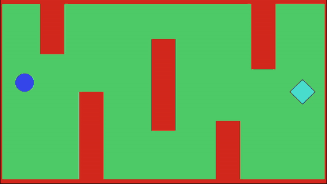
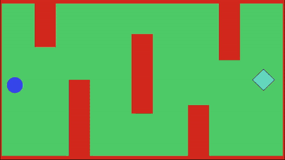
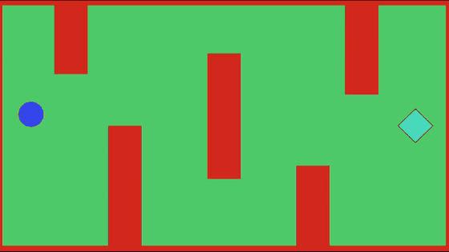
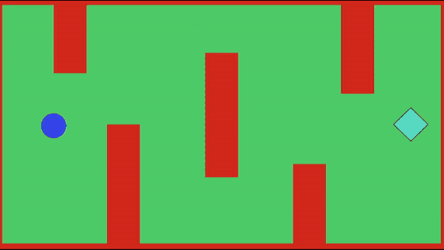

# AI_Tests

Навчальний проєкт на Unity, у якому я порівнюю різні способи довести персонажа до цілі у 2D-лабіринті: від ручного керування до агента, навченого з підкріпленням.

## Порівняння

Усі чотири варіанти проходять один і той самий рівень: старт ліворуч, ціль (бірюзовий ромб) праворуч, червоні стіни заважають пройти напряму.

| Гравець | Власний скрипт (Raycast) |
|:---:|:---:|
|  |  |
| **NavMesh** | **ML-Agents** |
|  |  |

## Технології

- Unity 6 (6000.3.2f1), Universal Render Pipeline (URP)
- Input System
- AI Navigation (NavMesh)
- ML-Agents: навчання PPO через Python-пакет `mlagents` (PyTorch)
- TextMesh Pro (UI)

## Підходи

### 1. Гравець

Ручне керування через Input System. Еталон, з яким порівнюються інші варіанти.

### 2. Власний скрипт: `MyScriptAI.cs`

- Персонаж рухається напряму до цілі
- Чотири промені Raycast: два «габаритні» вперед на ціль і два бічні
- Коли попереду стіна, персонаж обходить її збоку; бічні промені визначають, у який бік обходити

### 3. NavMesh: `NavGoal.cs`

- NavMeshAgent і NavMeshSurface з пакета AI Navigation
- Для 2D-сцени навігаційна сітка запікається по прихованих 3D-копіях стін
- Обертання агента вимкнене, щоб спрайт не перевертався

### 4. ML-Agents: `AgentAI.cs`, `AITrainer.cs`

- **Спостереження:** вектор від агента до цілі. **Дії:** неперервний рух по осях X і Y
- **Винагороди:** плюс за наближення до цілі, мінус за віддалення і за кожен крок, +2 за досягнення цілі, −1 за зіткнення зі стіною
- 21 агент навчається паралельно. `AITrainer` перезапускає «покоління» кожні 30 секунд або коли всі агенти вибули; UI показує час, кількість активних агентів і номер покоління
- PPO з рекурентною пам'яттю та curiosity для дослідження карти, близько 500 тисяч кроків навчання. Готова модель: `results/MyAI_ver1/MyAI.onnx`
- Режим Heuristic: агентом можна керувати вручну, щоб перевірити середовище

## Запуск

Відкрийте папку проєкту в Unity Hub (Unity 6000.3.2f1 або новіша) і запустіть сцену `Assets/Scenes/SampleScene.unity`.

Щоб навчити агента заново, потрібен Python із пакетом `mlagents`:

```
mlagents-learn Configs/trainer_config.yaml --run-id=MyAI_ver2
```

Після запуску команди натисніть Play в редакторі Unity. Параметри навчання лежать у `Configs/trainer_config.yaml`.

## Висновки

- NavMesh виявився найпростішим і найнадійнішим рішенням для такої задачі
- Власний скрипт на Raycast працює на цьому рівні, але залежить від форми перешкод
- ML-агент навчився проходити лабіринт, але для цього знадобилися сотні тисяч кроків навчання і підбір винагород
